# Neural Networks Are Already Clean — the explainer video

A 35-minute animated guide to Nick Cammarata's essay
[Neural Networks Are Already Clean](https://already-clean.goodfire.com/) (Goodfire, 2026). A narrator walks through the
essay's argument in the third person, crediting the people and papers it draws on. Clawd, a small silent tourist,
travels through sixteen worlds, each in its own art style (deep space, a toy town, a 1930s cartoon, film noir, spy
titles, a Victorian street, a botanical plate, a game show, a cryptid hunt, a pixel city, a pop-up book, a pub, a
savanna, a globe of postcards, a World's Fair poster and a jungle). A passport map marks the four parts, and the essay's
own figures and photographs appear throughout.

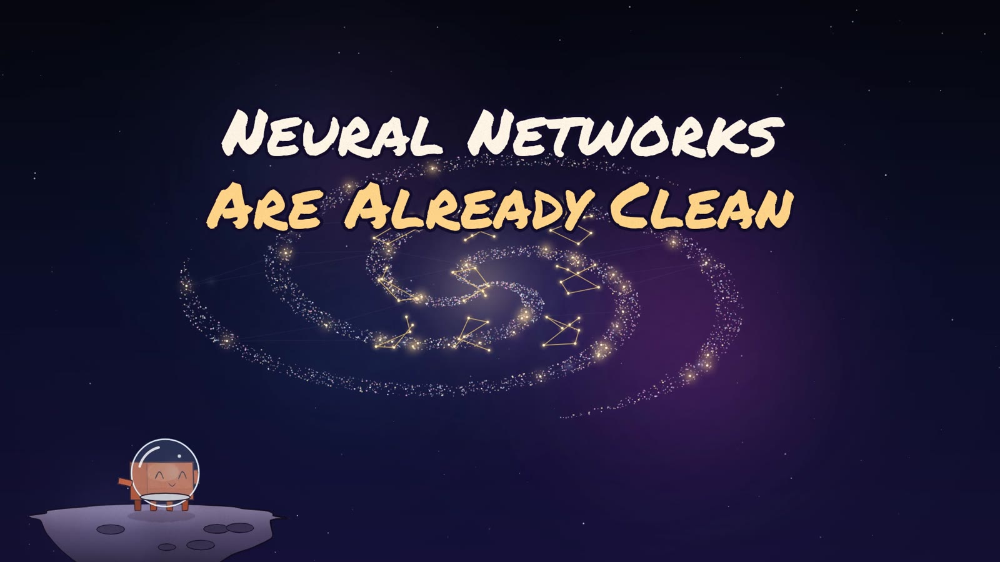

The narration is voiced with ElevenLabs ("Chris"); the music is procedural, one cue per world.

## Chapters

```
00:00  Stop 0  the question       What happens inside an AI?
01:18  Stop 1  neurons            What a neuron is
02:45  Stop 2  the knot           The knot
04:28  Stop 3  the cat & car case The case of the cat and the car
06:56  Stop 4  the hidden car     The case of the hidden car
08:40  Stop 5  better tools       Better tools, clearer neurons
10:32  Stop 6  how they grow      Watching a neuron grow
12:13  Stop 7  two theories       Two explanations
14:52  Stop 8  a moving target    The superposition of the gaps
17:01  Stop 9  gates & votes      Gates, votes and whispers
19:49  Stop 10 language models    Language models
23:12  Stop 11 testing labels     Explanations that can lose
24:46  Stop 12 why it's clean     How networks learn to be clean
27:34  Stop 13 what clean means   What "clean" means
30:53  Stop 14 AI scientists      The lab of the future
32:32  Stop 15 why it matters     Why it matters
```

## Stills

One frame from each stop, in order:

| 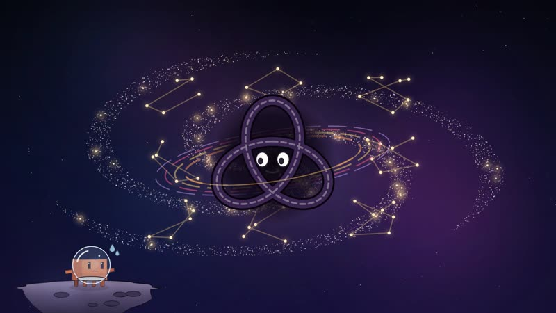 | 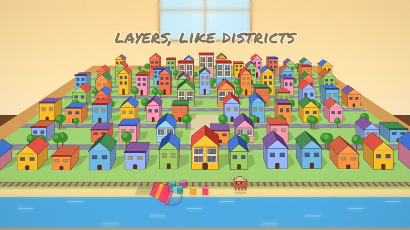 | 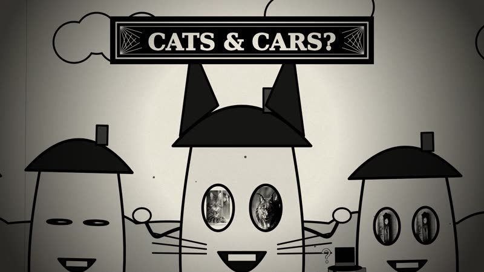 | 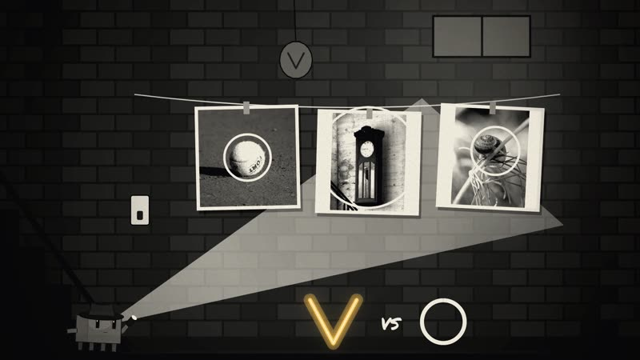 |
|---|---|---|---|
| 0 · the question | 1 · neurons | 2 · the knot | 3 · the cat & car case |
| 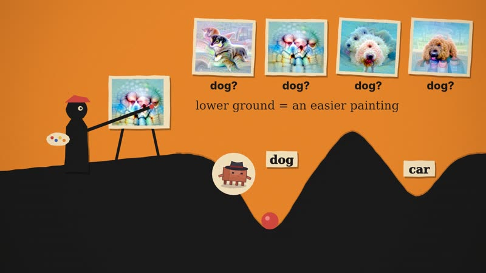 | 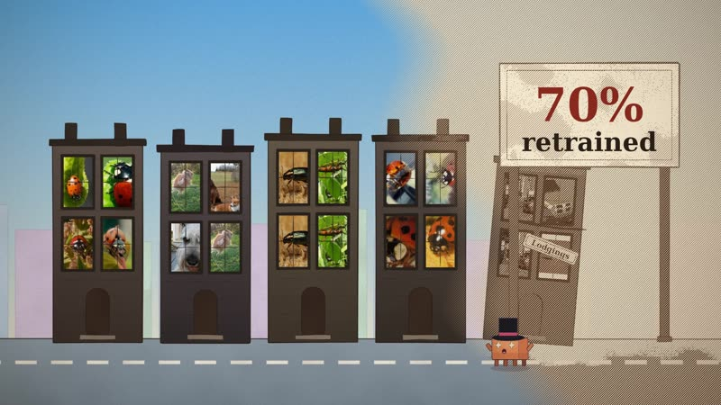 | 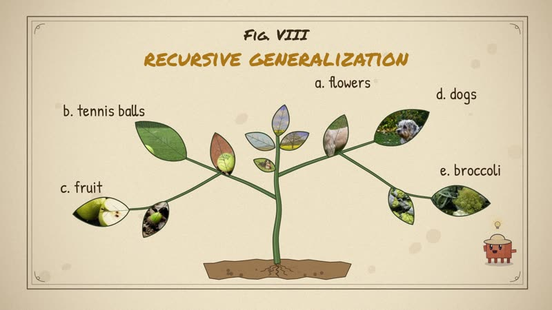 | 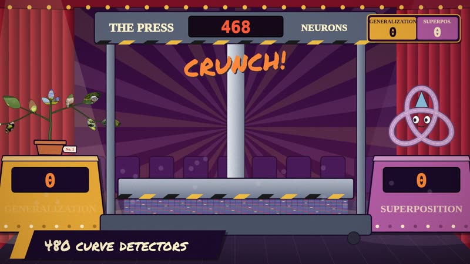 |
| 4 · the hidden car | 5 · better tools | 6 · how they grow | 7 · two theories |
| 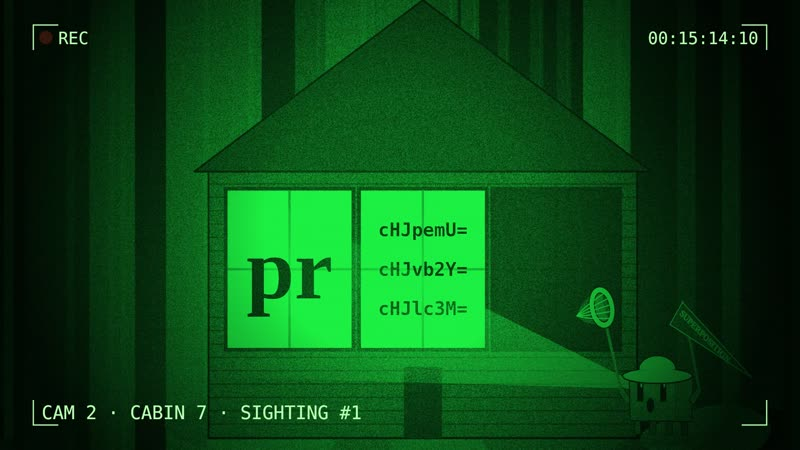 | 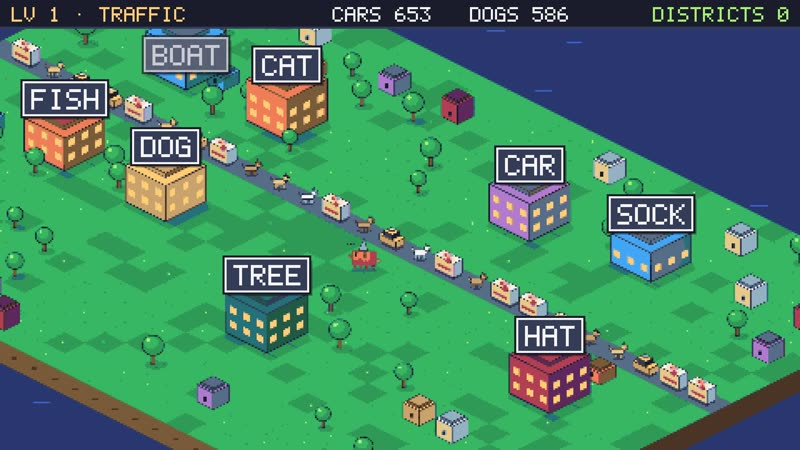 | 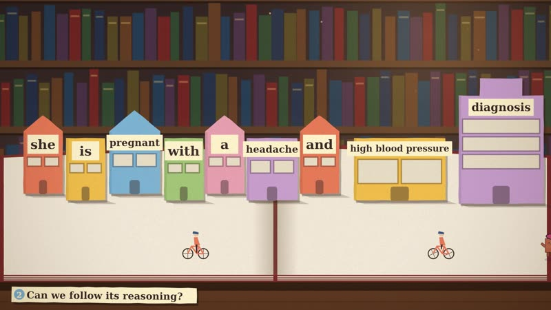 | 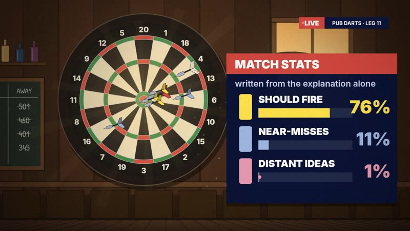 |
| 8 · a moving target | 9 · gates & votes | 10 · language models | 11 · testing labels |
| 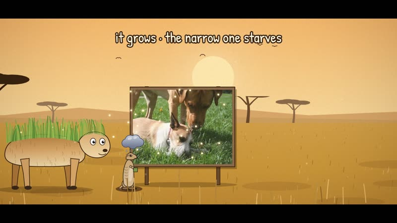 | 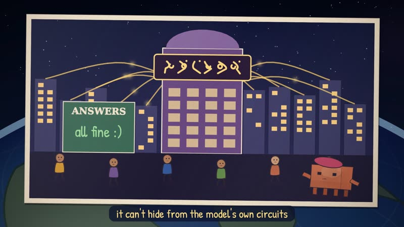 | 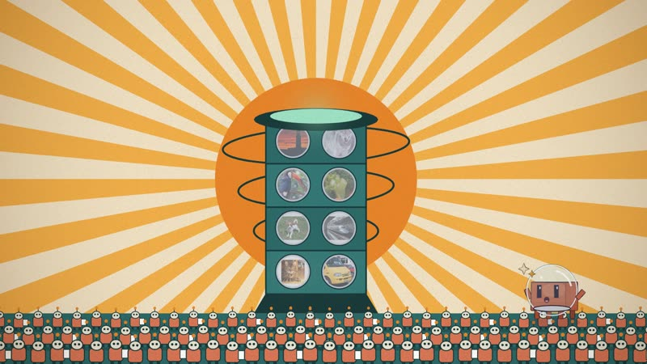 | 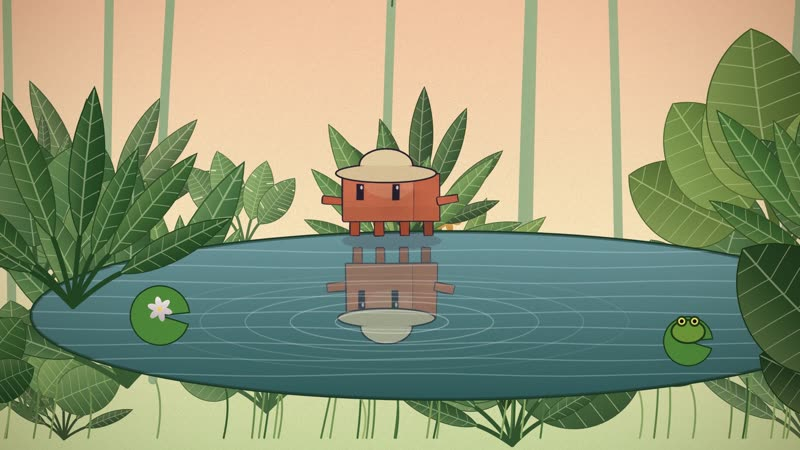 |
| 12 · why it's clean | 13 · what clean means | 14 · AI scientists | 15 · why it matters |

## How it works

- `script/script.md`: the narration (117 cues). `[cue_id]` marks a beat the picture syncs to; `{display|spoken}` fixes
  pronunciation without changing the subtitles; `(pause s)` adds silence, inline or at the end of a cue.
- `tools/tts.py`: voices each cue (cached), transcribes it with Whisper for word timings and a check that the voice said
  the script (`audio/qa.txt`), and lays out the timeline (`audio/timeline.json`), the voice track and `out/subtitles.srt`.
- `tools/score.py`: the music. Each world has a small procedural cue (instruments, tempo, harmony and level in its `S`
  entry), ducked under the voice, with a soft chime at each world change; writes `audio/music.wav` and the final mix
  `audio/mix.wav` (-16 LUFS).
- `engine/`: a CPU (Skia Canvas2D) painting engine. `clawd.js` draws Clawd (world hats and held props ride its pose),
  `styles.js` the per-world styling, stamps and stops, `teleport.js` the portals between worlds and the part-break map.
- `scenes/`: one file per world (`c00_space.js` … `c15b_recap.js`). Shots and beats are keyed to cue and word times
  (`cs('cue')`, `wt('cue', 'word')`), so the picture re-times itself whenever the narration changes.
- `render.mjs`: contact sheets and frame strips for review, and the parallel video render (resumable 60 s segments,
  then concat and mux with voice, music and soft subtitles).

## Rebuild

```bash
npm install
node tools/fetch_assets.mjs                      # the essay's images and figures → assets/blog (not committed)
python tools/derive_assets.py                    # crops single photos out of the essay's composite figures
ELEVENLABS_API_KEY=... python tools/tts.py --provider=elevenlabs --voice=iP95p4xoKVk53GoZ742B
python tools/score.py                            # music + final mix
node tools/check.mjs                             # every sampled frame renders; every word cue resolves
node render.mjs --video --workers=4 --out=out/video_final.mp4
```

Python needs `faster-whisper soundfile scipy numpy`; the video build needs `ffmpeg`. Rendered video, audio and the essay's
images stay out of git (see `.gitignore`); `node render.mjs --video` writes the film with soft subtitles, and
`tools/tts.py` writes `out/subtitles.srt`.

## Review tools

- `node render.mjs --sheet=T1,T2,… --out=x.jpg` (stills) and `--strip=a:b` (every frame of a stretch)
- `node tools/motionaudit.mjs --range=a:b` (hard jumps, empty frames, static stretches) and `tools/textaudit.mjs` (text off the frame)
- `python tools/music_preview.py ch05 out.m4a` (one world's cue under the narration) and `python tools/music_tour.py out.m4a` (15 s of every world)
- `node tools/clawd_posesheet.mjs out.jpg` (Clawd in every pose with each hat), `tools/clawd_probe.mjs` + `tools/clawd_crops.mjs`
  (record every Clawd draw in a range, then close-up crops of the hardest moments)

## Reusing this for another video

`.claude/skills/explainer-video/` is a Claude Code skill that packages this pipeline and the lessons from making this
film (script rules, visual system, voice and music, review loop, delivery). In a session on this repo, paste a blog post,
essay or book chapter and ask for an explainer video (or run `/explainer-video`). To have it in every project on your
own machine, copy the folder to `~/.claude/skills/explainer-video/`.

## Older material

`STORYBOARD.md`, `TREATMENT.md`, `WORLDS.md` and `BUILD_BRIEF.md` are planning documents from earlier passes (some written
for a first-person narration and a shorter cut); `script/script.md` and `scenes/` are the source of truth. `scenes_v1/`,
`scenes_v2/`, `engine/prof.js`, `engine/world.js`, `engine/world2.js` and `tools/music.py` belong to those earlier cuts and
are kept for reference only.

## Credits

- **The essay:** [Neural Networks Are Already Clean](https://already-clean.goodfire.com/) by Nick Cammarata (Goodfire, 2026).
  The argument, examples, figures and photographs shown in the film are from the essay and the work it cites, including
  Chris Olah and colleagues' circuits research and the Multimodal Neurons team at OpenAI, and Anthropic's
  interpretability papers.
- **The animation base:** this project and its `explainer-video` skill are built on [ClaudeAnimationBase](https://github.com/JohnHeibel/ClaudeAnimationBase)
  by John Heibel (MIT, see [`engine/LICENSE-ClaudeAnimationBase`](engine/LICENSE-ClaudeAnimationBase)). Its painterly
  Canvas2D toolkit, its Clawd character and its frame-as-a-function-of-time approach are the foundation here:
  `engine/core.js` is a CPU (Skia) re-implementation of its `core.js` paint API, and `engine/clawd.js` and the render
  pipeline grew out of its Clawd and renderer. [PDoomVideo](https://github.com/JohnHeibel/PDoomVideo), also by John Heibel,
  was the reference for building a narrated explainer on that base.
- **Voice:** ElevenLabs, voice "Chris". **Music:** procedural, generated by `tools/score.py`.
